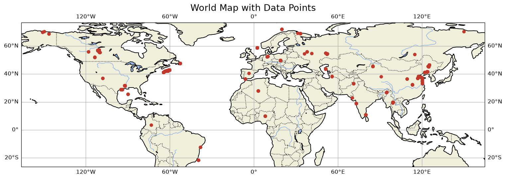

<a name="top"></a>
<p align="center">
  
</p>
<h2 align="center">Community curated database of oil metagenomes</h2>

<p align="center">
  <a href="https://github.com/agni-bioinformatics-lab/OilMetagenomesDB/stargazers"></a>
  <a href="https://github.com/agni-bioinformatics-lab/OilMetagenomesDB/watchers"></a>
  <a href="https://github.com/agni-bioinformatics-lab/OilMetagenomesDB/blob/main/LICENSE"></a>
  <a href="https://github.com/agni-bioinformatics-lab/OilMetagenomesDB/actions/workflows/tests.yml"></a>
  <a href="https://oilmetagenome.streamlit.app/"></a>
  <!-- DOI badge: add after the first Zenodo release -->
</p>

<br/>

Community  curated database of the metagenome of oil and oil fields🛢️🦠

+ [Description](#description)
+ [Usage](#usage)
+ [Samples Column Specifications](#samples-column-specifications)
+ [Libraries Column Specifications](#libraries-column-specifications)
+ [Contributing](#contributing)
  + [Some tips](#some-tips)
+ [How to cite](#how-to-cite)
+ [Acknowledgements](#acknowledgements)

<span id="description"></span>
## Description <a href="#top"></a>
This list contains information of oil connected metagenomes which include crude oil samples, samples from the different parts of oil production system in oil fields, also the samples from contaminated soil and water. This database is crucial for the use of metagenomic oil samples in machine learning. It follows the FAIR data organization principles. Here you can find the name of publications, years of publications, DOI, type of samples, geographic location of sample collection, and associated physical or chemical conditions.

The database will release bug fix updates on issues from the GitHub that have been reported every half a year. You can always create new issues and make a tag to become our contributor.

A web interface for browsing and filtering the sample table lives in [`app/`](app/). It reads `common_samples/common_samples.tsv` directly, so the table and the interactive map stay in sync with the repository.

The hosted app is available at [oilmetagenome.streamlit.app](https://oilmetagenome.streamlit.app/). To run the same interface locally:

```bash
pip install -r app/requirements.txt
streamlit run app/streamlit_app.py
```
<!-- START-MAP-INSERT -->

<!-- END-MAP-INSERT -->

<span id="usage"></span>
## Usage <a href="#top"></a>
<details>
  <summary>🎋Click for branch creation tutorial</summary>

  
</details>

<details>
  <summary>📋Click to learn data addition and pull request review</summary>

  
</details>

<details>
  <summary>⚙️Click to view data validation</summary>

  
</details>

<details>
  <summary>🧪Click to run the validation locally</summary>

The checks that run on pull requests can also be run on your computer before you open one (Python 3):

```bash
python -m venv .venv
.venv/bin/pip install -r requirements.txt

# Every row of both tables against the JSON schemas, duplicates, unique columns, archive_accession links
.venv/bin/python scripts/validate_local.py

# The pull-request checks: old rows unchanged, appended rows valid.
# --base-ref is the branch with the accepted tables (e.g. main, or upstream/main in a fork)
.venv/bin/python scripts/validation_samples.py --base-ref upstream/main
.venv/bin/python scripts/validation_libraries.py --base-ref upstream/main
.venv/bin/python scripts/validation_srs.py

# Tests of the validation scripts
.venv/bin/python -m pytest tests
```

Run `python scripts/validation_samples.py --help` for all options (`--table`, `--schemas`, `--base-file`).
</details>
 
If you find dataset validation errors or think of a new dataset validation, please create an [issue](https://github.com/agni-bioinformatics-lab/OilMetagenomesDB/issues) in our GitHub repository. 

<span id="samples-column-specifications"></span>
## Samples Column Specifications <a href="#top"></a>

The SAMPLES table stores information about the sample before it was sequenced: type, date of collection, geographic coordinates, depth, temperature of sample extraction, material of sample, etc.

Numeric and text fields must be filled in with "None" (capitalized) to indicate 'there can be no value meaningfully' or "unknown" to indicate 'value is not known, but theoretically could be'. For example, if only water is being tested in a sample and there is no oil in the sample, the API index would be "None" because there is no oil in that sample and there can be no viscosity index. Conversely, if the viscosity index in the "crude oil" sample was not measured, then the API column should be set to "unknown".

All columns with 'defined categories' should be validated against
`schemas_samples/<column>.json`. This is necessary to ensure data consistency.

If you wish to add a new category, please consult with the [agni-bioinformatics-lab](https://github.com/agni-bioinformatics-lab), and then add it to `schemas_samples/<column>.json`.

Sample columns are described in the [documentation](https://github.com/agni-bioinformatics-lab/OilMetagenomesDB/tree/main/assets/documentation/samples).

<span id="libraries-column-specifications"></span>
## Libraries Column Specifications <a href="#top"></a>
The LIBRARIES table stores information about each sequencing run of a library: IDs in databases, sequencing type (paired-end, single-end), sequencing strategy (WGS, RNA-Seq, amplicon), links to downloads and publications, etc.

Numeric and text fields must be filled in with "None" (capitalized) to indicate 'there can be no value meaningfully' or "unknown" to indicate 'value is not known, but theoretically could be'. For example, if only water is being tested in a sample and there is no oil in the sample, the API index would be "None" because there is no oil in that sample and there can be no viscosity index. Conversely, if the viscosity index in the "crude oil" sample was not measured, then the API column should be set to "unknown".

All columns with 'defined categories' should be validated against
`schemas_libraries/<column>.json`. This is to ensure data consistency. E.g., all
libraries sequenced on Illumina NextSeq 500s are listed as `nextseq 500` (as
defined in `schemas_libraries/instrument_model.json`).

Library columns are described in the [documentation](https://github.com/agni-bioinformatics-lab/OilMetagenomesDB/tree/main/assets/documentation/libraries).

<span id="contributing"></span>
## Contributing <a href="#top"></a>
Samples added to the OilMetagenomesDB should come from published studies. Samples should also be available in publicly accessible databases (e.g., EBI ENA or NCBI SRA).

When filling in the data, each sample from the publication will get a new row. For guidance on what information to add to each column see the [step-by-step instructions](assets/documentation/instructions/README.md) and the "Usage" section above.

<span id="some-tips"></span>
### Some tips <a href="#top"></a>
* Do not add spaces at the end of data entries, for example the "geo_loc_name" column is checked against a predetermined list of countries, so if you type “China ” rather than just “China” there’ll be an issue as it won’t match.
* To check the columns that must match a predefined list, see enums
* If latitude and longitude are not specified, if the publication has only a very approximate location (such as a region), then click in the center of that region and record the latitude and longitude to 2 decimal places only.
  * If only a country with no additional information is specified as a sample location, enter the coordinates of the middle of that particular country, but without the decimal places.
* Be sure to record the correct archive_accession. These should be ‘SRA sample’ IDs (i.e. ERS or SRS for the ENA and NCBI SRA respectively); please ask the core team if you are in doubt or have a different archive. Each row holds exactly one sample accession (`schemas_samples/archive_accession.json` does not accept lists). Always go with the sample accession rather than the run accession (SRR/ERR), which belongs in `archive_data_accession` of the libraries table.

<span id="how-to-cite"></span>
## How to cite <a href="#top"></a>
A paper describing OilMetagenomesDB is in preparation, and versioned releases with a DOI are planned. Until then, please cite the repository with the date you accessed it and the commit you used:

> OilMetagenomesDB: community curated database of oil metagenomes. https://github.com/agni-bioinformatics-lab/OilMetagenomesDB (accessed YYYY-MM-DD, commit `<hash>`).

Please also cite the original studies of the samples you use; their DOIs are in the `publication_doi` column of both tables.

<span id="acknowledgements"></span>
## Acknowledgements <a href="#top"></a>
We aimed to create a comprehensive database to serve as the foundation for our machine learning models, as no existing database provides such extensive insights into oil metagenomic patterns. And our team would like to express our gratitude to [AncientMetagenomeDir](https://www.spaam-community.org/AncientMetagenomeDir/) for inspiring us to create this public database. We would also like to thank ITMO University, AGNI and Tatneft for supporting the project.
